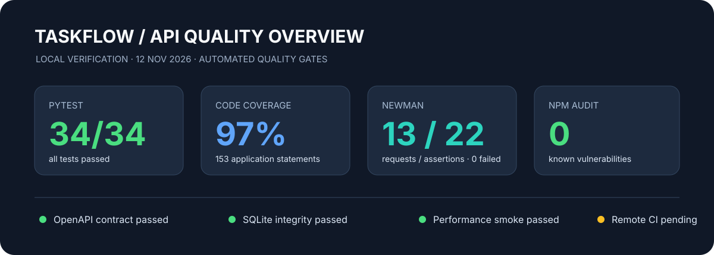
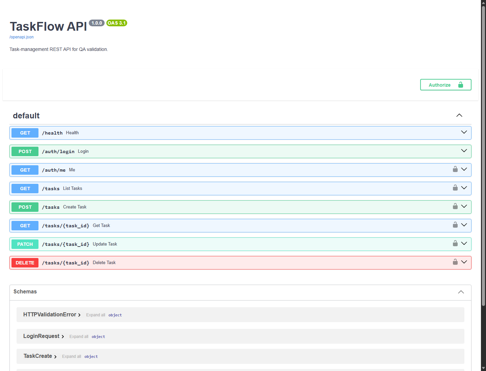
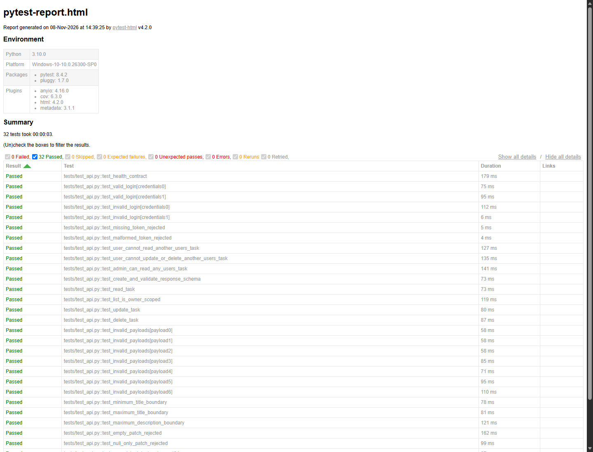
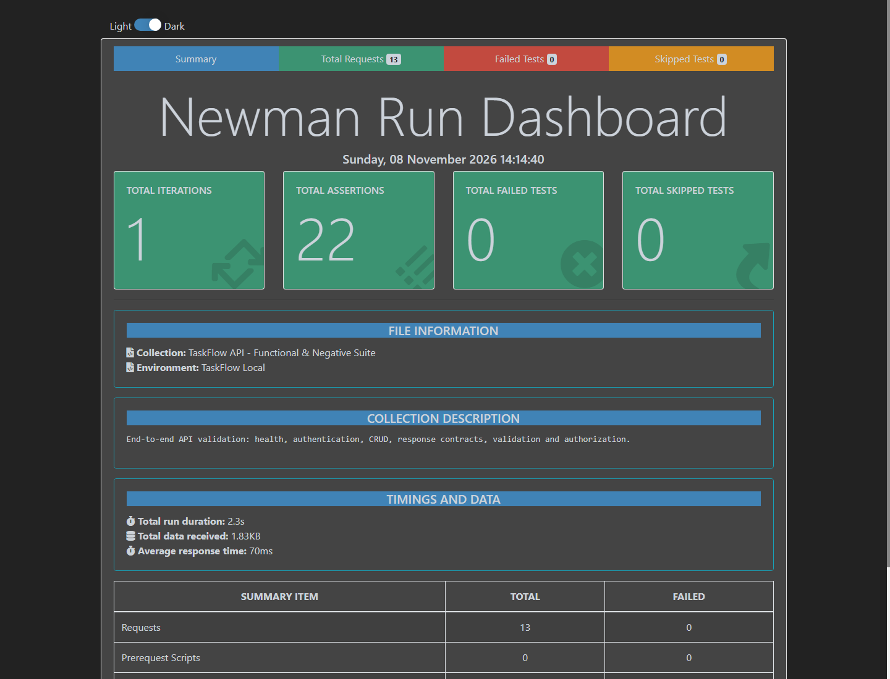

# Project 02 · API Testing & Validation Framework

A portfolio-grade API quality engineering project built around **TaskFlow**, a deliberately scoped task-management REST API. It demonstrates how an SQA engineer designs, automates, validates, reports, and continuously checks API behavior.

<p align="center">
  
</p>

<p align="center">
  
  
  
  
</p>

## Project at a glance

| Area | Implementation |
|---|---|
| API under test | FastAPI, REST, OpenAPI |
| API automation | Python, Pytest, FastAPI TestClient |
| API client testing | Postman collection, Newman CLI |
| Data layer | SQLite, SQL integrity and constraint checks |
| Contract validation | OpenAPI snapshot and drift detection |
| Performance | 40-request latency smoke test |
| Reporting | Pytest HTML/JUnit, Newman CLI/JUnit/HTML, JSON metrics |
| CI/CD | GitHub Actions |

## Quality evidence

The following figures are from the latest local verification run on **12 November 2026**. They are local results, not a claim that the remote GitHub Actions workflow has passed.

| Quality gate | Latest result |
|---|---:|
| Pytest | **34 passed, 0 failed** |
| Python statement coverage | **97%** |
| Newman | **13 requests, 22 assertions, 0 failures** |
| npm audit | **0 vulnerabilities** |
| OpenAPI contract drift check | **Passed** |
| SQLite integrity | **Passed** |
| SQLite foreign-key violations | **0** |
| Performance smoke | **Passed** |

The performance check is intentionally a small regression smoke test. It is not a load, stress, or capacity benchmark.

## What is tested?

- **Authentication:** valid and invalid login, missing, malformed, expired, and tampered bearer tokens.
- **Authorization:** role-based access, owner isolation, cross-user read/update/delete restrictions.
- **CRUD:** create, list, retrieve, update, and delete task workflows.
- **Negative testing:** missing fields, unexpected properties, invalid enum values, malformed IDs, and invalid patch requests.
- **Boundary testing:** minimum and maximum title/description lengths.
- **Contract testing:** response shape and generated OpenAPI schema drift.
- **Database testing:** persistence, foreign-key constraints, CHECK constraints, referential integrity, and deletion.
- **Performance smoke:** repeated health endpoint requests with a p95 regression threshold.

## Architecture and request flow

TaskFlow seeds three local demo accounts: an administrator, a standard QA user, and a second standard user. Passwords are PBKDF2-hashed. Signed bearer tokens are used for authentication. Standard users can access only their own tasks; administrators can access all tasks.

See [architecture and request lifecycle](docs/architecture.md).

## Screenshots and reports

### Interactive API documentation


### Automated Python test report


### Postman/Newman execution report


The screenshots are visual evidence samples. The generated HTML/JUnit reports are recreated locally and are intentionally excluded from Git to keep the repository lean. CI uploads fresh reports as workflow artifacts.

## Run locally

### 1. Python environment

Windows PowerShell:

```powershell
py -m venv .venv
.\.venv\Scripts\Activate.ps1
python -m pip install -r requirements.txt
```

### 2. Run automated tests

```powershell
New-Item -ItemType Directory -Force reports | Out-Null
pytest -v --html=reports/pytest-report.html --self-contained-html --junitxml=reports/pytest-junit.xml --cov=app --cov-report=term-missing
```

### 3. Start the API

```powershell
python -m uvicorn app.main:app --reload
```

- API health: http://127.0.0.1:8000/health
- Swagger UI: http://127.0.0.1:8000/docs
- OpenAPI JSON: http://127.0.0.1:8000/openapi.json

### 4. Run contract and performance checks

```powershell
npm ci
npm run contract:check
npm run performance:smoke
```

The performance script expects the API to be running. It sends 40 sequential requests to `GET /health`, reports min/median/p95/max latency, and enforces a 500 ms p95 ceiling.

### 5. Run Postman/Newman

With the API running:

```powershell
npm run postman:test
npm run postman:html
```

The collection and local environment are in `postman/`. The environment contains no saved bearer tokens; login requests populate tokens during the run.

## Demo credentials

| Role | Username | Password |
|---|---|---|
| Administrator | `admin` | `Admin123!` |
| Standard user | `qa_user` | `User123!` |
| Standard user | `second_user` | `User123!` |

These credentials are for the local demonstration only. Never reuse them in a deployed environment.

## Database verification

```powershell
python scripts/db_check.py
```

Tests use an isolated database at `data/test_api.db`; normal API runs use `data/api_testing.db`. Database files are excluded from Git.

## CI pipeline

The GitHub Actions workflow in `.github/workflows/api-tests.yml` is configured to:

1. Install Python dependencies and verify the OpenAPI snapshot.
2. Run Pytest with coverage and HTML/JUnit reports.
3. Install Node dependencies and run `npm audit`.
4. Start the API service.
5. Run the performance smoke check.
6. Execute the Postman collection with Newman.
7. Upload reports as workflow artifacts, including on failure.

**CI status:** workflow configured; remote execution must be confirmed from the repository's Actions tab after publication.

## Security, limitations, and scope

This is a QA demonstration, not a production identity platform. The application uses a local development signing-secret fallback and public demo credentials. Production use would require managed secrets, TLS, rate limiting, token lifecycle hardening, password recovery, and a mature identity provider.

The performance check is low-volume smoke evidence, not load-test evidence. The upstream Newman dependency chain currently includes a deprecated transitive package warning; the current `npm audit --audit-level=moderate` check reports zero known vulnerabilities.

## Repository structure

```text
app/                  FastAPI application under test
tests/                Pytest functional, negative, auth and DB tests
postman/              Postman collection and local environment
contracts/            OpenAPI contract snapshot
scripts/              Contract, performance and DB verification utilities
docs/                 Architecture and screenshot evidence
reports/              Report output directory (generated files ignored)
.github/workflows/    GitHub Actions CI pipeline
```

## License

MIT. See [LICENSE](LICENSE).
