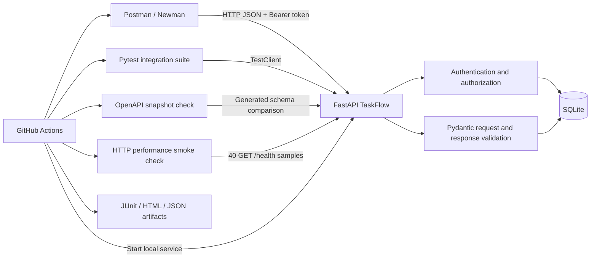

# TaskFlow API - Architecture

TaskFlow is a deliberately small REST service used to demonstrate API quality engineering. The service is the system under test; test layers exercise it through both in-process and real HTTP paths.

## System view

## Request lifecycle

1. A client sends a JSON request to FastAPI.
2. Pydantic validates incoming fields and rejects unknown properties on task payloads.
3. Protected routes validate bearer-token signature and expiry, then resolve the account.
4. Authorization enforces administrator access or task ownership.
5. The service reads or writes SQLite with foreign-key enforcement enabled.
6. Response models constrain the public task representation.
7. Pytest, Newman, performance checks, and OpenAPI drift checks validate separate quality dimensions.

## Quality layers

| Layer | Tool | Purpose |
|---|---|---|
| Functional, negative, boundary, authorization, database | Pytest | Fast feedback with isolated database state |
| Real HTTP workflows and assertions | Postman + Newman | Validate client-visible request/response behavior |
| Contract stability | OpenAPI snapshot script | Detect unreviewed schema changes |
| Basic latency regression | Python urllib smoke script | Record min/median/p95/max for a small health-check sample |
| Continuous integration | GitHub Actions | Run gates and retain reports |

## Scope and limitations

The performance script is a small regression smoke check, not a load test or capacity claim. The OpenAPI snapshot detects generated-schema changes; updates must be reviewed and committed intentionally. The local demo secret and seeded credentials are not production secrets.
